٢٠٢٤-١٠-٢٩ ٢٢:٣٨

الحالة:

العلامات: [[البرمجة]]

```mermaid
flowchart TB

A[Python Basics] --> B[Introduction and The Basics of Programming]

B --> B1[Understanding Variables]

B1 --> B1a[Variable Assignment: equals sign - assigns a value to a variable]

B1 --> B1b[Data Types: int, float, str - types of data in Python]

B1a --> B1a1[Video: Variable Basics]

B1b --> B1b1[Video: Data Types Overview]

B --> B2[Data Types: Integers, Floats, Strings]

B2 --> B2a[Practice: Data Types Section]

B --> B3[Basic Input/Output]

B3 --> B3a[Input: input keyword - gets user input]

B3a --> B3a1[Video: Input Function]

B3 --> B3b[Output: print keyword - displays output to the console]

B3b --> B3b1[Video: Print Function]

B --> B4[Control Structures: If, Else, Elif]

B4 --> B4a[If Statement: if, else, elif keywords - controls flow based on conditions]

B4a --> B4a1[Video: Control Structures]

A --> C[Sequences and Iteration]

C --> C1[Lists: Creation, Accessing Elements]

C1 --> C1a[List Methods: append keyword - adds an item to the end of a list, remove keyword - removes an item, index keyword - finds the position of an item]

C1a --> C1a1[Video: Working with Lists]

C1a --> C1a2[Practice: Lists Section]

C --> C2[Tuples: Immutability]

C2 --> C2a[Tuple Creation: parentheses - creates a tuple, Accessing Elements - retrieves items from a tuple]

C2a --> C2a1[Video: Tuples Explained]

C --> C3[For Loops: Iterating Over Sequences]

C3 --> C3a[For Loop Syntax: for item in list keyword - iterates through each item in a list]

C3a --> C3a1[Video: For Loops]

C --> C4[While Loops: Conditional Iteration]

C4 --> C4a[While Loop Syntax: while condition keyword - repeats as long as the condition is true]

C4a --> C4a1[Video: While Loops]

  

A --> D[Booleans and Conditionals]

D --> D1[Boolean Values: True, False - represent truth values]

D1 --> D1a[Video: Boolean Basics]

D --> D2[Logical Operators: AND, OR, NOT - combine or negate conditions]

D2 --> D2a[Video: Logical Operators]

D2 --> D2b[Using in Conditions: if a and b keyword - checks if both conditions are true]

D2b --> D2b1[Practice: Boolean Logic Section]

D --> D3[Using Booleans in Conditions]

  

A --> E[Sequence Mutation and Accumulation Patterns]

E --> E1[Modifying Lists: Append, Remove]

E1 --> E1a[List Methods: append keyword - adds an item, extend keyword - adds multiple items, insert keyword - adds an item at a specific position]

E1a --> E1a1[Video: Modifying Lists]

E1a --> E1a2[Practice: List Modification Section]

E --> E2[Accumulation Patterns: Sum, Average]

E2 --> E2a[Using Loops for Accumulation - calculates totals or averages]

E2a --> E2a1[Video: Accumulation Patterns]

E --> E3[Using Loops for Accumulation]

  

A --> F[Debugging Skills]

F --> F1[Reading Error Messages - understanding what went wrong]

F1 --> F1a[Video: Debugging Techniques]

F --> F2[Using Print Statements for Debugging]

F2 --> F2a[Print Syntax: print keyword variable - outputs variable values for checking]

F2a --> F2a1[Practice: Debugging Section]

F --> F3[Understanding Reference Diagrams - visualizing data flow and relationships]
```

[![](https://mermaid.ink/img/pako:eNqVV21P20gQ_isjfza92EkL5MNJkIBUqRQEaSud6YeJvUlWOF53d01IUf_7zb7GDr3THR8IeJ-ZeeaZF29ek1JULJkmq1rsyg1KDYv5YwP0c1Hc7fVGNHCJipfqO5yc_AmXxcdGS1F1peZ0hE0Fiw3zEBAruJNiLXG75c36u_Nz6Qyz4ktTMak02dAhfEXJcVkzFWCZx2ERjuBCKb5utqzRU2A_OqwVmAdwAmhPFCA8Y90x0ML-6eyOPS6LOWqExb5lagq80SlQukgfSktyps2BIV8ZGG_AJR7dYGCWFV95xcQ0kg_aBOQyRIzIQ2S4fWbymbPdUJd8QI7UZWtSKYVrw5A-H7QkuWKI3FthcSeRilCyQYwHZgszDDEuLE1y3nb6j9tO00dAjD0EC3tq5KEPeGL7nZAVibNmWkGnmHQn0Q6DYUzVOoDrrhlQCAGWhQs8hZYS6keouGpr3FMFLMDUUlNPlaJR4lDM8TI4igHvrKPjgA42KWbCdGptBKRu7aSVd5XCVa2Y-c1XwWLiTUiDFcFRM9dynNDMohmhA2NFlEvnW5k-2sESFauAxoEeV9xwieWaYPAdWb_l5cF-7KzBrHighmdNSTU1Q_ZRM4m9LGcOlRWfuNKU2Ewye5zCRUk2ykzYVW3zCO5nmbdBawQ3jJq8IltsW0YhDgXBqjJRgZMQoRoGQROCUJNtCpJtxTPr2bgH0SylbqnYSw-wogfKumqFsiJZfw4eKWLgGOX6JuSTyWbH9QZstm_BeW8YLORoDrxaebHo2tr2wXbbaVzymut9wOQehA4VJaWGRUk6bphitvbmuckUtMH9TnGrB80tM4qY_KhRpNgGkxgRQ8iYrSMIVy80Ebxh1TCBcXEtJHwSojU5uJagsGaxQOyXYDL2NhiN4GHfaHyZwooe2OLSrjP17JWJW6_MVEqKbr0BhuUmgl35YwQMISL_yG9IfFJ823DS1FOfhTnB-m1nT7wJ9mwi8519FOds0IAt1YXKoqAWJAqqsEU8lNMD2UXx_WTOepPZ40io_jjOi0tBuwgbN409_iHRucNlAUivCHovUa4LiknbnJDMsaSBpx4xXKih7dsr-si8EwyMgrPBa8aHyotPYs1LkvC2NRIKSdEuPs9TuL1P4fPtwu6p7ZLaCKgqDVtTXd-uqHnu3cWgb9weI5fFF9vu1BBRCfNiNevByLPslaXcsPJJmbOloHwP4YGGql8QchvcZ71xDgpYUkdj7YUYezqxRANeR5W8iosVbmgFxFsMDXG37Wr34A41dWWU6MpZZsWNqPhqb2L5tXthV2cK93b7BXjm8f9r0dJL5kX_5phIaW72kd0jZq_Su1j_07ZGTTVQLSv5iuQKmzYSw8As9vxRSm-Rx7vVWVCDWKWGBfFC5cVv1ZzCQ0dpXtC2wnUUK_c26Ktox89uqIET6iSsS_Of2U1Cm7sgYdA5i7z9Sr3qrdT_UNnxv8Y-6qDrYs6W3XptDB6eeB1XwLU7zop7hvaKeyUlubqhl4OhSCl0gxvwbkPV2pldsJMiXpevM-8mzuMh3IKVm4b_OGwMHzL3_N2FKN5gXCrRPNjk3shcIS3e79bhvSxcpom2u5epwyO3tax3O9995xi896e4p9igYTz_8dF3g3u2YtLO6Jyj-TphxHvmir4B8J8GYC_q9u5lZlcyVyi14bS5kzTZMrlFXtHXmlcT5zGhN8GWPSZT-rNC-fSYPDa_CIedFpR9mUzNIkoT-8ZLpiuzrNOkaykM8wwCpMXmLyH6_ybT1-QlmZ6M87Pzd6Oz96P8w-j8_WR0mib7ZJpn-btslJ9-GJ1NsvOzs7PTX2ny03o4f5dlhM5Pz8fj96PJKP_1N7_vZiQ?type=png)](https://mermaid.live/edit#pako:eNqVV21P20gQ_isjfza92EkL5MNJkIBUqRQEaSud6YeJvUlWOF53d01IUf_7zb7GDr3THR8IeJ-ZeeaZF29ek1JULJkmq1rsyg1KDYv5YwP0c1Hc7fVGNHCJipfqO5yc_AmXxcdGS1F1peZ0hE0Fiw3zEBAruJNiLXG75c36u_Nz6Qyz4ktTMak02dAhfEXJcVkzFWCZx2ERjuBCKb5utqzRU2A_OqwVmAdwAmhPFCA8Y90x0ML-6eyOPS6LOWqExb5lagq80SlQukgfSktyps2BIV8ZGG_AJR7dYGCWFV95xcQ0kg_aBOQyRIzIQ2S4fWbymbPdUJd8QI7UZWtSKYVrw5A-H7QkuWKI3FthcSeRilCyQYwHZgszDDEuLE1y3nb6j9tO00dAjD0EC3tq5KEPeGL7nZAVibNmWkGnmHQn0Q6DYUzVOoDrrhlQCAGWhQs8hZYS6keouGpr3FMFLMDUUlNPlaJR4lDM8TI4igHvrKPjgA42KWbCdGptBKRu7aSVd5XCVa2Y-c1XwWLiTUiDFcFRM9dynNDMohmhA2NFlEvnW5k-2sESFauAxoEeV9xwieWaYPAdWb_l5cF-7KzBrHighmdNSTU1Q_ZRM4m9LGcOlRWfuNKU2Ewye5zCRUk2ykzYVW3zCO5nmbdBawQ3jJq8IltsW0YhDgXBqjJRgZMQoRoGQROCUJNtCpJtxTPr2bgH0SylbqnYSw-wogfKumqFsiJZfw4eKWLgGOX6JuSTyWbH9QZstm_BeW8YLORoDrxaebHo2tr2wXbbaVzymut9wOQehA4VJaWGRUk6bphitvbmuckUtMH9TnGrB80tM4qY_KhRpNgGkxgRQ8iYrSMIVy80Ebxh1TCBcXEtJHwSojU5uJagsGaxQOyXYDL2NhiN4GHfaHyZwooe2OLSrjP17JWJW6_MVEqKbr0BhuUmgl35YwQMISL_yG9IfFJ823DS1FOfhTnB-m1nT7wJ9mwi8519FOds0IAt1YXKoqAWJAqqsEU8lNMD2UXx_WTOepPZ40io_jjOi0tBuwgbN409_iHRucNlAUivCHovUa4LiknbnJDMsaSBpx4xXKih7dsr-si8EwyMgrPBa8aHyotPYs1LkvC2NRIKSdEuPs9TuL1P4fPtwu6p7ZLaCKgqDVtTXd-uqHnu3cWgb9weI5fFF9vu1BBRCfNiNevByLPslaXcsPJJmbOloHwP4YGGql8QchvcZ71xDgpYUkdj7YUYezqxRANeR5W8iosVbmgFxFsMDXG37Wr34A41dWWU6MpZZsWNqPhqb2L5tXthV2cK93b7BXjm8f9r0dJL5kX_5phIaW72kd0jZq_Su1j_07ZGTTVQLSv5iuQKmzYSw8As9vxRSm-Rx7vVWVCDWKWGBfFC5cVv1ZzCQ0dpXtC2wnUUK_c26Ktox89uqIET6iSsS_Of2U1Cm7sgYdA5i7z9Sr3qrdT_UNnxv8Y-6qDrYs6W3XptDB6eeB1XwLU7zop7hvaKeyUlubqhl4OhSCl0gxvwbkPV2pldsJMiXpevM-8mzuMh3IKVm4b_OGwMHzL3_N2FKN5gXCrRPNjk3shcIS3e79bhvSxcpom2u5epwyO3tax3O9995xi896e4p9igYTz_8dF3g3u2YtLO6Jyj-TphxHvmir4B8J8GYC_q9u5lZlcyVyi14bS5kzTZMrlFXtHXmlcT5zGhN8GWPSZT-rNC-fSYPDa_CIedFpR9mUzNIkoT-8ZLpiuzrNOkaykM8wwCpMXmLyH6_ybT1-QlmZ6M87Pzd6Oz96P8w-j8_WR0mib7ZJpn-btslJ9-GJ1NsvOzs7PTX2ny03o4f5dlhM5Pz8fj96PJKP_1N7_vZiQ)

---

المراجع:
